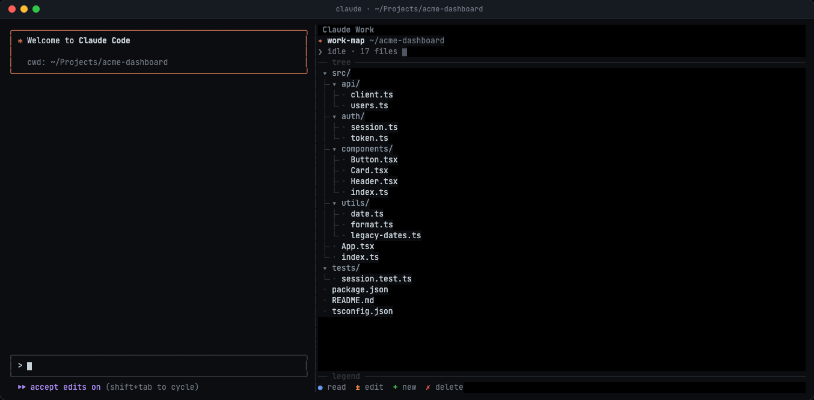

# Claude Work Visualized

[](https://github.com/rollecode/claude-work-visualized/releases)
[](https://claude.com/claude-code)
[](hooks/)
[](LICENSE)

A Claude Code plugin that adds a live, animated map of your project next to the chat. Every file Claude reads, edits, creates or deletes lights up in the tree as it happens, and every edit is replayed as keystrokes in a code view beside it.

<p align="center">
  
</p>

This is Rolle's fork of [GrzeskoByte/claude-work-visualized](https://github.com/GrzeskoByte/claude-work-visualized). It adds the code view, syntax highlighting, one-line edit results in the chat, remote work over `ssh`, `scp` and `rsync`, and replays of files changed by shell commands. See the [changelog](CHANGELOG.md).

## Features

- **Live file tree.** The project is scanned at session start and rescanned every 1.5 seconds, so changes from scripts, builds and your editor show up too.
- **A look per operation.** Read, edit, create and delete each have their own colour, glyph and animation.
- **Current file.** The file Claude is on gets the strongest animation, a `▌` marker and a `◂ editing` label, and the path down to it lights up.
- **Fading trail.** Touched files stay marked and fade back to normal over about a minute.
- **Code view.** Each `Edit` and `Write`, and each file a shell command changes (`sed -i`, `>`, `tee`, a script that rewrites a file it names), is replayed as keystrokes: replaced lines turn red and fold away, new lines type in behind a caret, and gutter marks stay for a while. Highlighting covers about 60 languages through Prism, in Tokyo Night colours.
- **Quiet chat.** While the pane is shown, an edit's result in the chat is one line (`± Edited src/app.ts +3 -1`), because the pane already shows the diff.
- **Remote work.** Files touched over `ssh`, `scp` and `rsync` show under a folder per host (`deploy@web1:/etc/nginx/…`), and the header names the host Claude is working on.
- **Completion card.** When a turn ends, a card counts the files viewed, edited, created and deleted.
- **Terminal friendly.** One-cell glyphs and box-drawing characters only, up to 30 fps while something moves, idle otherwise.

## Installation

Requires [Claude Code](https://claude.com/claude-code) with function-hooks plugins, tested on 2.1.288 and later. The function-hooks API is in early access and may change between releases. The pane opens by itself in a terminal at least 144 columns wide, and the colours are tuned for a dark theme.

### From the marketplace

This repository is also a plugin marketplace:

```sh
claude plugin marketplace add rollecode/claude-work-visualized
claude plugin install work-visualized@claude-work-visualized
```

The same works inside Claude Code as `/plugin marketplace add …` and `/plugin install …`. Start a new session and the work map loads.

Update and remove with:

```sh
claude plugin marketplace update claude-work-visualized
claude plugin update work-visualized@claude-work-visualized
claude plugin uninstall work-visualized@claude-work-visualized
```

### From a local clone

```sh
git clone https://github.com/rollecode/claude-work-visualized.git
claude --plugin-dir ./claude-work-visualized
```

`--plugin-dir` loads the plugin for one session and reloads it on every save. To load it in every session, put the folder's absolute path in `CLAUDE_CODE_PLUGIN_DIRS` in the `env` block of `~/.claude/settings.json`:

```json
{
  "env": {
    "CLAUDE_CODE_PLUGIN_DIRS": "/home/you/claude-work-visualized"
  }
}
```

### Recommended Claude Code settings

The pane works best when the chat stays short. The GIF above runs with these in `~/.claude/settings.json`:

```json
{
  "verbose": false,
  "bashEditDiffEnabled": false
}
```

`verbose: false` keeps tool output collapsed to one line (`Ctrl+O` still opens the full transcript), and `bashEditDiffEnabled: false` stops Claude Code from printing a diff after each shell command that changes files. Claude Code turns that diff on by default in auto mode.

## Usage

| Command | What it does |
| --- | --- |
| `/watch` | Opens or closes the pane. The choice is remembered across sessions. |
| `/diffs` | Switches edit results in the chat between one line and the full diff. Also remembered. |

- Closing the pane by hand also turns watching off, and the next `/watch` reopens it.
- While a tool runs, the status line shows the current operation, for example `± edit src/app.ts`.
- Scroll over the code view (mouse wheel, touchpad, or the arrow and page keys with the pane focused) to move through the whole edited file. Claude's next edit brings the view back to following it.

If nothing appears, start Claude Code with `claude --debug`. The debug log names the plugin and the reason whenever a hook fails or the module does not load.

## Visual language

| Glyph | Operation | Colour | While running | After |
| --- | --- | --- | --- | --- |
| `◉` | read | blue | a band of light sweeps across the name | `✓`, colour fades |
| `±` | edit | orange | a ripple runs along the name, then a blinking cursor `▏` | `✓`, colour fades |
| `+` | create | green | the name types itself in, then glows | settles into the tree |
| `✗` | delete | red | red pulse | highlight, damped shake, removed letter by letter |

<table>
  <tr>
    <td align="center"><br><sub><b>Reading</b>: the scan band sweeps the name</sub></td>
    <td align="center"><br><sub><b>Editing</b>: ripple, cursor and lit path</sub></td>
  </tr>
  <tr>
    <td align="center"><br><sub><b>Creating</b>: the name types itself in</sub></td>
    <td align="center"><br><sub><b>Deleting</b>: red pulse, then shake and dissolve</sub></td>
  </tr>
  <tr>
    <td align="center" colspan="2"><br><sub><b>Task complete</b>: the trail of the turn and its summary</sub></td>
  </tr>
</table>

<sub>All media is rendered from the plugin's own drawing code, so the pane in it is exactly what the plugin draws. [`scripts/render-session.mjs`](scripts/render-session.mjs) makes the GIF at the top, with the chat column as a mockup of Claude Code, and [`scripts/render-media.mjs`](scripts/render-media.mjs) makes the stills.</sub>

The full timelines and colours are in [docs/visual-language.md](docs/visual-language.md).

## Limitations

- **Shell commands.** Files touched by `rm`, `mv`, `cp`, `touch`, `mkdir`, `cat`, `sed -i`, `>` and similar are recognised from the command text. Anything else is caught by the rescan after the command and shown as finished, without a running phase.
- **Other folders.** Files outside the session folder show under `~:/` (your home folder) or `local:/`. Shell commands are followed through `cd` and `NAME=value`.
- **Remote work.** Only what the command text names is shown. Remote folders are not scanned, so a change a remote script makes on its own is not seen.
- **Changes made outside Claude** animate too, but the completion card counts only what Claude's own tool calls changed.
- **Skipped folders.** `node_modules`, `.git`, `dist`, `build`, caches and virtual environments are left out of the tree.
- **Code view.** A shell command's change is replayed only for files the command names, up to 4 per command. Files over 256 KB are skipped, and one replay shows at most 80 lines.
- **Size.** A scan covers at most 2,000 entries, 12 levels deep.

## Documentation

- [Architecture](docs/architecture.md): how tool calls become animations
- [Visual language](docs/visual-language.md): glyphs, colours and every timeline
- [Development](docs/development.md): project layout, testing, type-checking and changing the plugin

## License

[MIT](LICENSE). Original plugin © 2026 Grzegorz Sierocki, fork changes by Rolle Laukkarinen.
